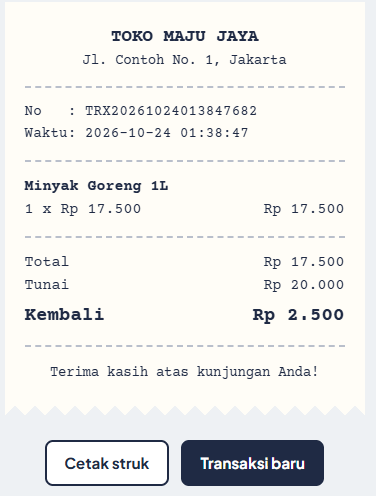

# 🛒 Sistem Kasir Toko

Aplikasi kasir (Point of Sale) sederhana dengan Python yang tersedia dalam **dua versi**: aplikasi web (Flask) dan aplikasi command line. Keduanya memakai logika bisnis yang sama di folder `kasir/`, sehingga tampilan dan logika terpisah dengan rapi. Proyek ini mensimulasikan alur kerja kasir di toko kelontong: mengelola produk, melayani transaksi, mencetak struk, dan membuat laporan penjualan harian.



## ✨ Fitur

**Versi web** menampilkan katalog produk dalam bentuk kartu yang bisa diklik, dengan keranjang belanja bergaya struk thermal di sampingnya. Tersedia tombol uang pas dan nominal cepat, halaman struk yang bisa dicetak langsung dari browser, tabel kelola produk, riwayat transaksi, dan laporan harian dengan grafik produk terlaris. Tampilannya responsif untuk layar HP.

Fitur yang ada di kedua versi:

- **Transaksi penjualan**: tambah/hapus barang di keranjang, hitung total, pembayaran tunai, dan kembalian
- **Diskon otomatis** 5% untuk belanja di atas Rp 100.000
- **Cetak struk** belanja yang rapi
- **Kelola produk (CRUD)**: tambah, lihat, cari, ubah, dan hapus produk
- **Manajemen stok**: stok berkurang otomatis setelah transaksi dan ada validasi stok tidak cukup
- **Laporan penjualan harian**: jumlah transaksi, total pendapatan, dan produk terlaris
- **Penyimpanan data** menggunakan file JSON, jadi data tetap ada setelah program ditutup
- **Unit test** dengan pytest

## 📸 Contoh Struk (versi CLI)

```
========================================
             TOKO MAJU JAYA
========================================
No   : TRX20261023160936003
Waktu: 2026-10-23 16:09:36
----------------------------------------
Beras 5kg
  1 x Rp 68.000                Rp 68.000
Mie Instan
  5 x Rp 3.500                 Rp 17.500
----------------------------------------
Total                          Rp 85.500
Tunai                         Rp 100.000
Kembali                        Rp 14.500
========================================
   Terima kasih atas kunjungan Anda!
========================================
```

## 📁 Struktur Proyek

```
sistem-kasir/
├── app.py               # Aplikasi web Flask
├── main.py              # Aplikasi command line (CLI)
├── templates/           # Halaman HTML (Jinja2)
├── static/style.css     # Tampilan web
├── kasir/
│   ├── __init__.py
│   ├── models.py        # Dataclass Produk & ItemKeranjang
│   ├── inventori.py     # Pengelolaan produk & stok
│   ├── transaksi.py     # Keranjang, checkout, struk, laporan
│   └── utils.py         # Format Rupiah & validasi input
├── data/
│   └── produk.json      # Data contoh produk
├── tests/
│   ├── test_kasir.py    # Unit test logika kasir
│   └── test_web.py      # Test aplikasi web
├── requirements.txt
├── LICENSE
└── README.md
```

## 🚀 Cara Menjalankan

**Prasyarat:** Python 3.8 atau lebih baru.

```bash
# 1. Clone repository
git clone https://github.com/Halimah-16/sistem-kasir.git
cd cashier-system

# 2. (Opsional) buat virtual environment
python -m venv venv
source venv/bin/activate      # Windows: venv\Scripts\activate

# 3. Install dependensi
pip install -r requirements.txt
```

**Versi web:**

```bash
python app.py
```

Lalu buka **http://127.0.0.1:5000** di browser.

**Versi command line:**

```bash
python main.py
```

## 🧪 Menjalankan Test

```bash
python -m pytest -v
```

## 🛠️ Teknologi

- Python 3 (dataclasses, type hints, pathlib, json)
- Flask dan Jinja2 untuk versi web
- HTML dan CSS murni (tanpa framework CSS)
- pytest untuk unit testing

## 🗺️ Rencana Pengembangan

- [x] Versi web dengan Flask
- [ ] Antarmuka desktop (Tkinter)
- [ ] Database SQLite
- [ ] Ekspor laporan ke Excel/PDF
- [ ] Login kasir dan admin
- [ ] Pembayaran non-tunai (QRIS, debit)

## 📄 Lisensi

Proyek ini menggunakan lisensi [MIT](LICENSE).
